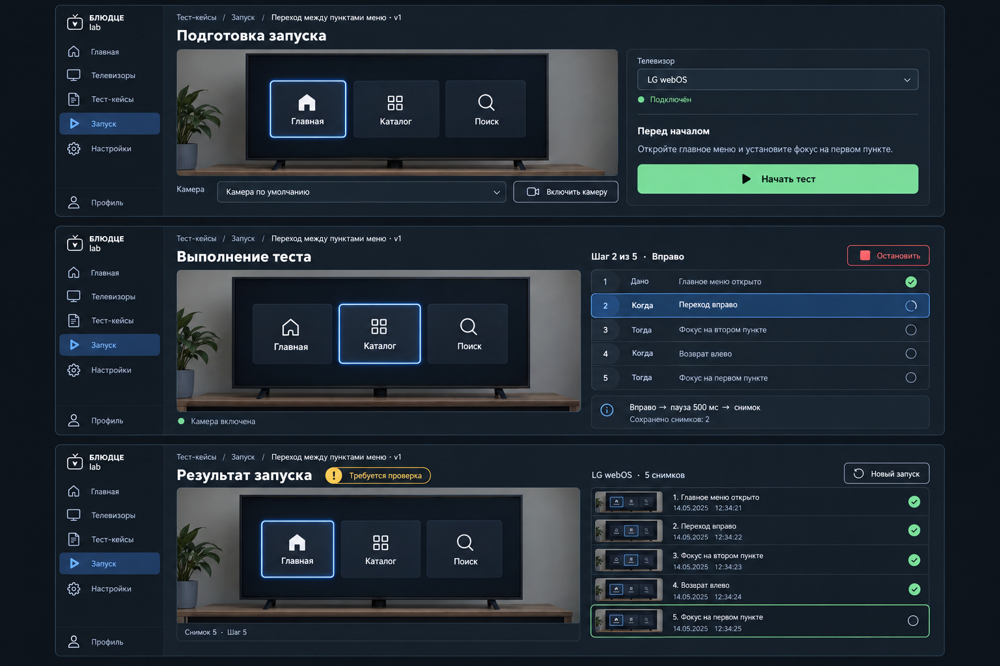

# Первый запуск со снимками

Статус: референс композиции, согласован 2026-10-16. Реализация использует
общие компоненты и дизайн-систему с поправками ниже.

ТЗ: [camera-runner-design](../../../superpowers/specs/2026-10-15-camera-runner-design.md).
Три состояния: подготовка (выбор ТВ/камеры и начальное состояние), выполнение
(живое видео, текущий шаг, остановка), отчёт (кадры и «Требуется проверка»).
Существующая палитра, навигация и компонент камеры обязательны. Генерированный
макет иллюстрирует композицию; точные размеры определяет общее дизайн-ТЗ.

Отклонения генерации, которые не переносим в реализацию:
- Бренд, подписи и активное меню должны соответствовать существующей оболочке,
  включая зелёный индикатор раздела; синий акцент обозначает только выполнение.
- Кнопка старта недоступна, пока камера не включена и готовность не проверена.
- Галочки рядом с кадрами не означают успешную проверку: в реализации использовать
  явную подпись «Снимок сохранён» и иконку снимка; ожидаемый результат не оценён.
- Даты на изображении условные; в приложении используются фактические времена.
- Камера и контролы переиспользуют существующий компонент и общие размеры.
