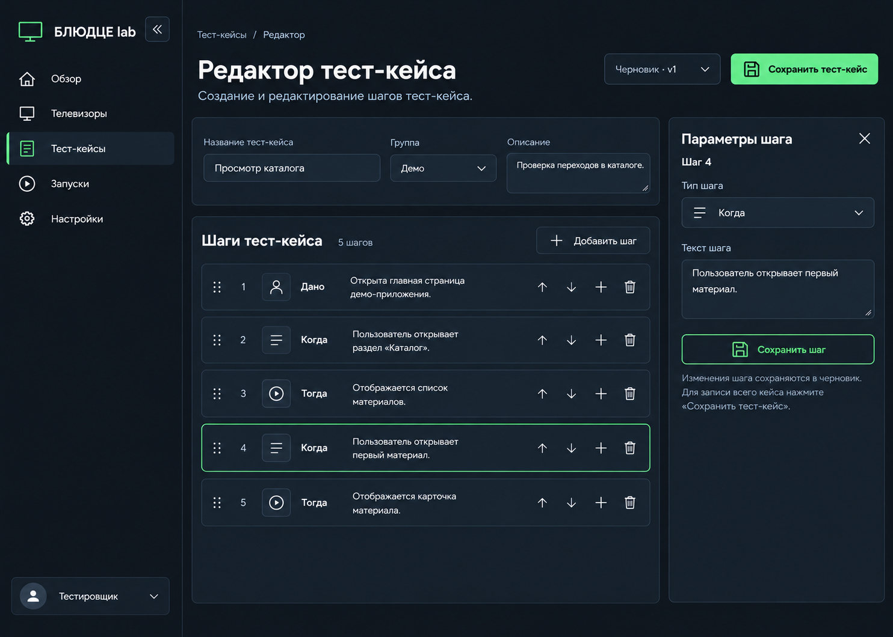
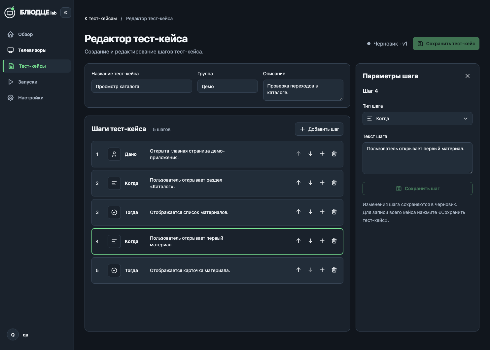
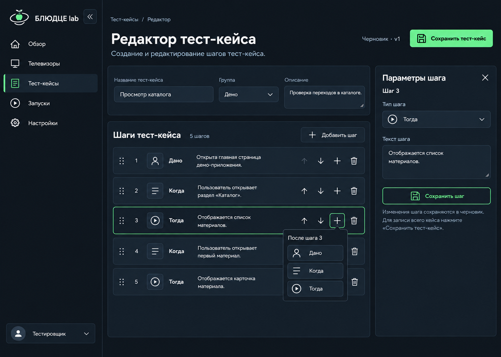
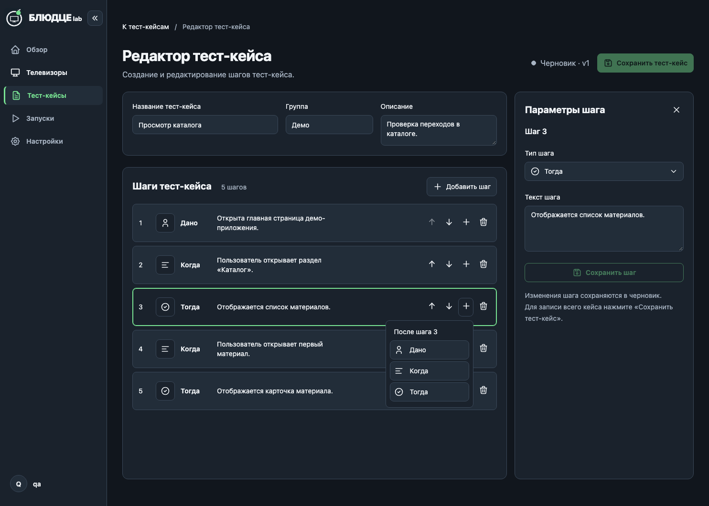

# Повторная сверка редактора с макетами и дизайн-ТЗ

Дата: 2026-10-13. Предыдущая формулировка о полной визуальной проверке была неверной; этот отчёт её заменяет. Исходные утверждённые макеты не изменялись.

Сверка выполнена в Chromium, тёмная тема, размер 1484×1060 — точный размер исходных изображений. В реализации использован тот же синтетический кейс «Просмотр каталога», группа «Демо», описание и пять текстов шагов из макета. Обе итоговые сцены показывают сохранённый черновик v1. До исправления панель выбранного шага и список были заметно плотнее макета.

## 1. Выбран шаг 4 — композиция исправлена

| Утверждённый макет | Реализация после правок |
|---|---|
|  |  |

[Снимок до исправления](01-before.png).

| Элемент | Было | Исправлено / проверено |
|---|---|---|
| Панели | Нижняя граница около 755 px; большая пустота снизу | Общая нижняя граница 1004 px, как в исходном макете |
| Список | Плотные строки 64 px, разделительные линии | Отдельно очерченные строки 80 px, рамка 1 px, радиус 8 px, промежуток 8 px |
| Действия строки | Маленькие рамки вокруг каждого значка | Контурные значки без постоянных рамок; компактная область 32 px, подсказки и доступные имена |
| Тип шага | Иконки не соответствовали визуальному направлению; выбор типа без значка | Контурный пользователь, строки, проверка в круге; тот же значок в поле типа и меню |
| Панель параметров | Не было закрытия; номер шага терялся | Закрытие, заметный номер, постоянные подписи полей; закрытие сохраняет правки и возвращает фокус |
| Поле текста | Высота около 158 px | Начальная высота 96 px, доступно увеличение |
| Сохранение шага | Узкая нейтральная кнопка | Контурное действие на всю ширину поля, акцентный цвет, понятная связь с сохранением кейса |
| Шапка | Дополнительные «Аккаунт» / «Выйти» над редактором | Убраны из редактора по макету; профиль доступен из общего меню |
| Состояния | Двойная наружная рамка при обычном клике | Выбор — тонкая рамка; клавиатурный фокус — 2 px, действия имеют собственный фокус |

## 2. Вставка после шага 3 — композиция исправлена

| Утверждённый макет | Реализация после правок |
|---|---|
|  |  |

Выбран третий шаг. Меню привязано к его плюсу, содержит три типа с иконками и контекст «После шага 3». В процессе повторной проверки найден и устранён конфликт: стиль компактных действий строки сжимал пункты меню до 32 px шириной. Теперь пункты занимают ширину меню (166 px внутри контейнера 184 px), имеют высоту 40 px. Escape отменяет выбор и возвращает фокус на плюс; исходные шаги не меняются до выбора типа.

## Явные противоречия источников

Приоритет определяется [продуктовым ТЗ](../../../superpowers/specs/2026-10-11-product-ui-design.md) и [правилами проекта](../../../../AGENTS.md): поздние согласованные требования → ТЗ → макет. Эти отличия сохранены открыто, а не признаны произвольно допустимыми:

| В изображении | В реализации | Основание |
|---|---|---|
| Меню около 303 px, внутренний отступ рабочей области около 16 px | Меню 224 px, отступ 32 px | ТЗ §3, §4; поэтому абсолютные координаты и ширины рабочих панелей отличаются |
| Заголовок около 40 px, крупнее подписи и поля | Заголовок 32/40, раздел 20/28, основной текст 14/20, поля и кнопки 40 px | ТЗ §4; переносы строк и размеры элементов не попиксельно идентичны изображению |
| Разные знаки бренда на двух макетах | Единый существующий знак БЛЮДЦЕ lab | ТЗ §3 |
| Градиентные поверхности | Плоские общие токены #11161D / #1A222C / #222D39 | ТЗ §2, §4 |
| Play рядом с «Тогда» | Проверка в круге | ТЗ §4: запуск — Play; проверка результата обозначается проверкой |
| Выпадающая группа и редактируемый статус в первом изображении | Текстовая группа, неизменяемый статус | Согласованный контракт редактора черновиков |
| Маркеры перетаскивания | Не показаны | Drag-and-drop не входит в согласованный этап; недействующие ручки не добавлены |
| Обе кнопки сохранения яркие | На итоговых снимках обе недоступны | Кейс и шаг уже сохранены; после изменения соответствующее действие включается |

Точного попиксельного совпадения не заявляется. Основные исправленные расхождения композиции показаны выше; остальные перечисленные отличия связаны с явными требованиями или состоянием сохранённого черновика.

## Проверки и пределы

- Веб-тесты: 380/380; отдельная проверка закрытия параметров с сохранением неприменённых правок.
- Проверка типов всех пакетов и веб-сборка успешны.
- Браузерный сценарий: порядок пяти шагов после повторного открытия, меню вставки, защита выхода, конфликт версий, ошибки сохранения, сессия и окно 640 px без горизонтальной прокрутки.
- Браузерные проверки геометрии: строка 80 px, поле текста 96 px, выбор типа 40 px, ширина кнопки сохранения равна ширине поля, нижние границы обеих панелей 1004 px. Проверены цвет фона и панели по общим токенам.
- Снимки после правок сохранены и просмотрены. Проверки функций и клавиатуры дополняют снимки; полная сертификация доступности не заявляется.
- Окончательный Docker на 8081 обновлён, вкладка безопасно перезагружена. В активном приложении осмотрены выбранный шаг и меню вставки; Escape вернул фокус на плюс. Сохранённые пользовательские кейсы не редактировались и не сохранялись.
