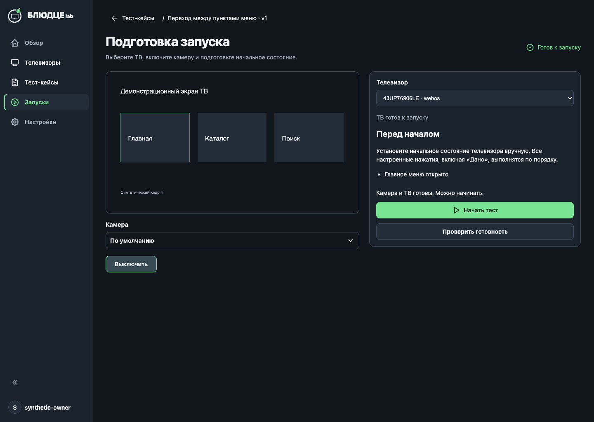
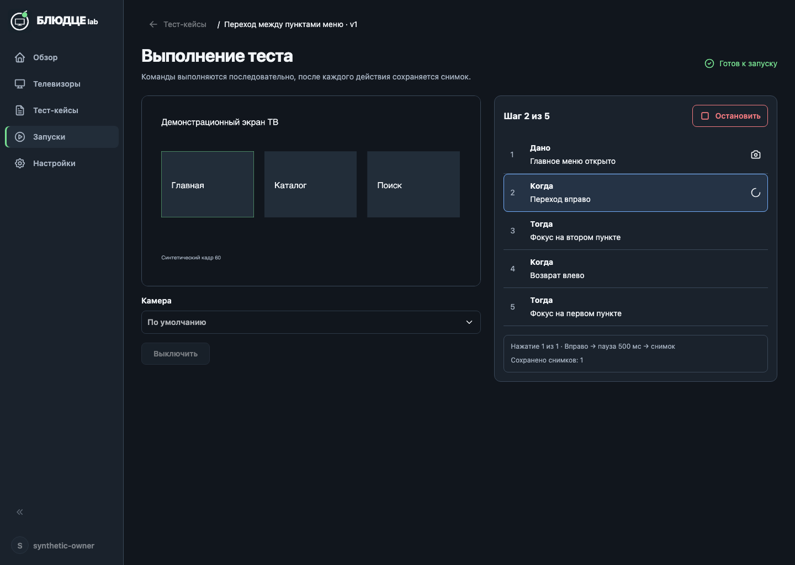
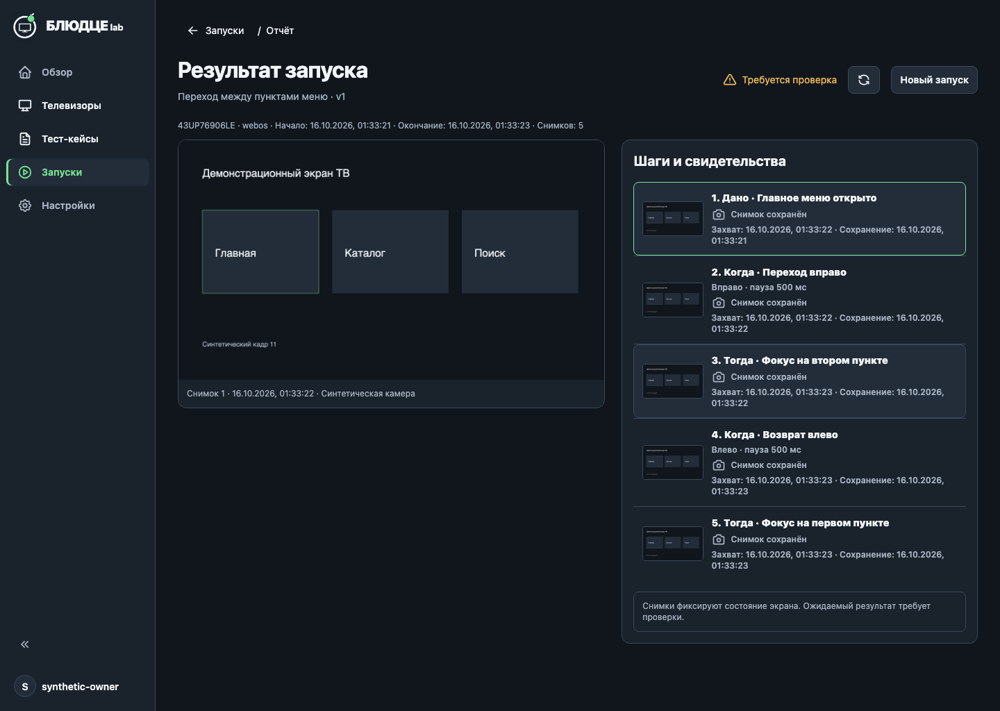
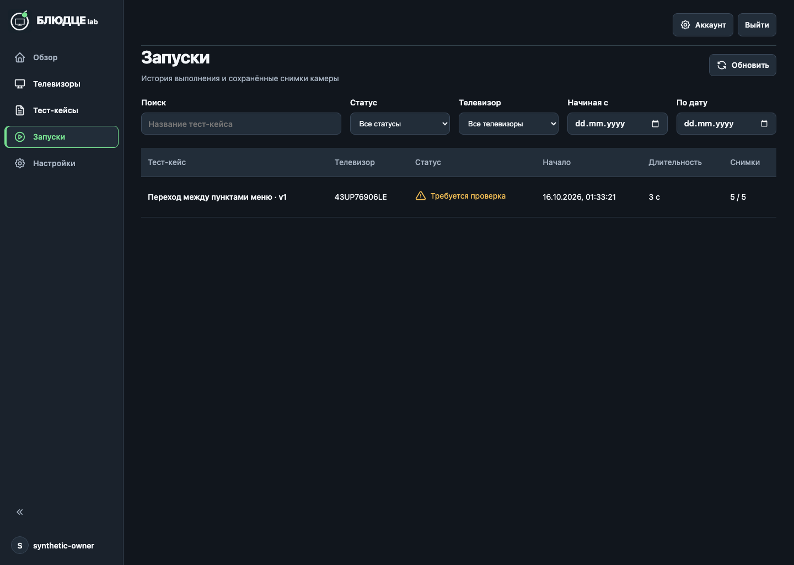

# Проверка запуска со снимками — 2026-10-16

Референсы: [общая дизайн-система](../../../superpowers/specs/2026-10-11-product-ui-design.md),
[ТЗ запуска](../../../superpowers/specs/2026-10-15-camera-runner-design.md),
[макет композиции](../../mockups/2026-10-15-runner/01-runner-flow.png).

Все изображения ниже получены из работающей сборки на viewport 1440×1024.
Сценарий, аккаунт, изображение камеры и транспорт ТВ синтетические;
пользовательские данные и реальные кадры не использованы.

## Визуальная сверка

- Существующая оболочка и бренд; меню 224 px, рабочие поля 32 px.
- Активный раздел — нейтральная поверхность и зелёная полоса; Play в круге.
- Камера слева, подготовка/шаги/свидетельства справа; внешней рамки страницы нет.
- Основной текст 14/20, заголовки 32/40 и 20/28; кнопки 40 px, токены общие.
- Старт зелёный, остановка красная, текущий шаг синий, проверка янтарная.
- Статус и подписи различимы без цвета; у снимков нет галочек успешной проверки.
- Ошибки и состояние камеры находятся вне видео, feedback камеры остаётся 44 px.
- Таблица истории использует тот же общий механизм оформления, что тест-кейсы.
- Отчёт раскрывает длинный список порциями, миниатюры загружаются лениво;
  текущий шаг выполнения автоматически остаётся в видимой части списка.

Отличия от сгенерированного макета намеренные и следуют ТЗ: исправлен бренд и
активное меню, существующие контролы камеры сохранены, статус готовности кейса
отделён от оборудования, вместо галочек — «Снимок сохранён». В отчёте сначала
выбран первый сохранённый кадр; пользователь может выбрать любой другой.

## Проверки

- `pnpm test`: 1536 проверок, включая контракты, API, UI и эмуляторы транспорта.
- `pnpm typecheck`, `pnpm build`: успешно. Сборщик сообщает о JS-пакете более
  500 kB; разделение загрузки приложения не входило в этот этап.
- `pnpm --filter @remote-webos-tv/web test:e2e test/e2e/test-runs.spec.ts`:
  пять разных JPEG, две команды с паузами 500 мс, последовательное сохранение,
  отчёт «Требуется проверка», reload без повторных команд, история.
- Отдельный gate старта проверяет отсутствие отметок сохранённых кадров до
  принятия запуска сервером. Gate второго upload позволяет проверить выполнение.
- Детерминированные проверки остановки во время команды и сохранения,
  истечения lease, SQLite failure, рестарта, идемпотентности и конфликта upload.
- Независимое ревью: четыре замечания исправлены с регрессионными проверками.
- `pnpm test:docker`: штатные проверки образа, постоянного volume, авторизации,
  перезапуска, протокольного эмулятора и ошибочных условий хранилища успешны.
- Существующий локальный Docker-preview пересобран с прежним внешним volume.
  Раздел «Запуски» проверен в браузере; реальный тест на ТВ не запускался.

## Решения исполнения

- Использована текущая feature-ветка: незакоммиченные изменения редактора нужны
  раннеру и сохранены. Стоимость решения — общий diff требует аккуратного ревью.
- Коммиты и push не выполнялись, чтобы не смешивать прежнюю работу пользователя
  с новой без отдельного решения об интеграции.
- История возвращает компактные сводки из SQLite; полный сценарий и список
  свидетельств запрашиваются при открытии отчёта. Это новый API, frontend и
  backend обновлены совместно; внешних потребителей пока не обнаружено.
- Локальный игнорируемый ledger сохранён до коммита, чтобы не потерять запись
  исполнения. Его стоимость — небольшой локальный служебный каталог.

Реальная приёмка: пользователь вручную выставляет начальное состояние ТВ и
явно нажимает «Начать тест». Сохранённые кадры требуют ручной оценки результата.

## Контрольные изображения

