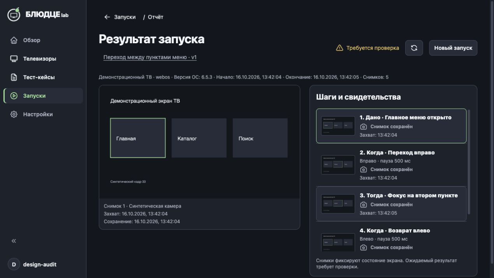

# Уточнения отчёта по замечаниям пользователя

Название/версия кейса оформлены ссылкой и открывают текущую сохранённую версию в редакторе через существующий механизм загрузки. Копия сценария внутри отчёта неизменна. Ошибка открытия видна в рабочей области. Кнопка обновления имеет стандартную подсказку title «Обновить отчёт» и доступное имя. У пояснения о ручной проверке удалена рамка.

Новые запуски сохраняют `tvPlatformVersion` из `identity.platformVersion`, который LG-адаптер получает из `sdk_version`. Прошивка в это поле не подставляется. Значение сохранено в JSON-документе запуска и возвращается в отчёте/истории; миграция SQL-таблиц не нужна. Поле необязательное: старые отчёты читаются без изменений и явно показывают «Версия ОС: не сохранена». Текущая версия устройства не подставляется задним числом.

Проверено: 442 теста веб-интерфейса, 281 тест контрактов; профильные API-тесты сервиса, хранения и маршрутов прошли, отдельный новый тест хранения версии ОС и совместимости старых записей также прошёл. Сборки API, web и Docker успешны; diff-check без ошибок.

Свежая браузерная проверка на отдельной копии той же сборки с синтетической камерой и ТВ: сохранены пять кадров, версия ОС 6.5.3 видна в отчёте; нажатие названия открыло редактор соответствующего кейса. Рамка отсутствует. Реальные команды ТВ не выполнялись. Поведение количества снимков этой правкой не изменялось.

Активный Docker обновлён с сохранением volume. Пользовательская вкладка показывает истёкшую сессию; для просмотра изменений требуется повторный вход. Авторизованный экран в этой вкладке после обновления не проверен.

Последующие согласованные изменения: постоянная кнопка обновления удалена; повторная загрузка доступна только при ошибке отчёта/изображения. Название кейса увеличено до 20/28 px и выровнено с заголовком; проверены hover без рамки и видимый клавиатурный фокус. Снимки: `report-no-refresh.png` и `report-aligned.png`.

Причина разлогиниваний во время QA уточнена: тестовый вход на другом порту `127.0.0.1` перезаписывал cookie приложения. Перезапуск с тем же хранилищем сессии сохраняет. Для синтетического стенда используется отдельный hostname.
