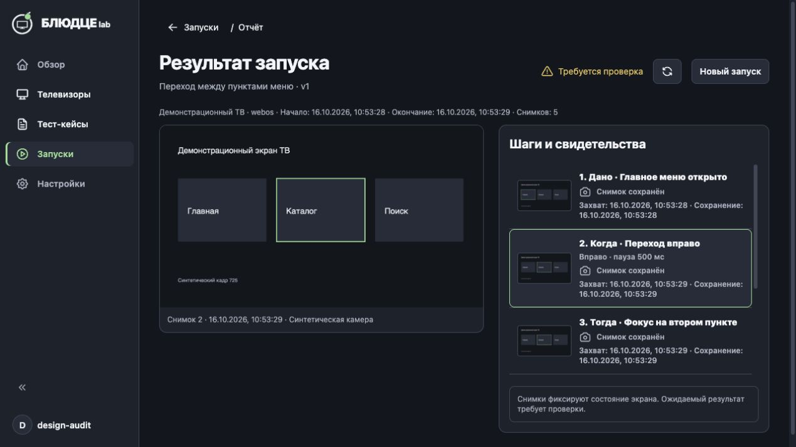
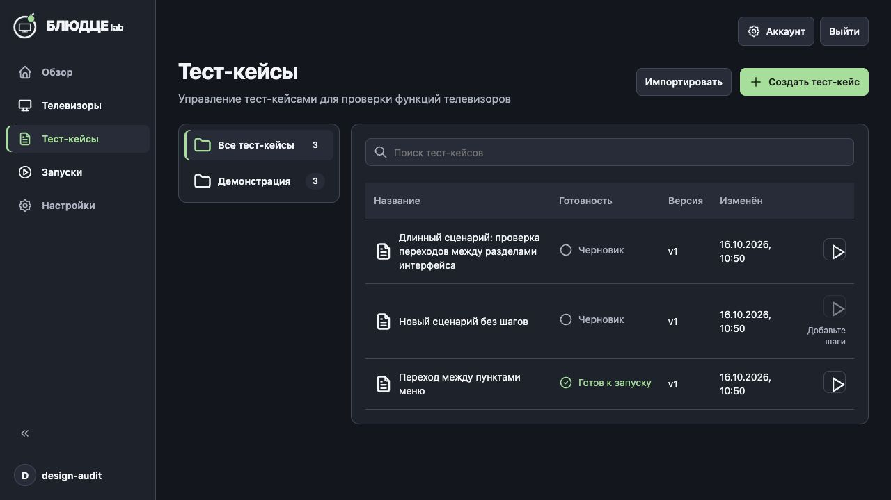
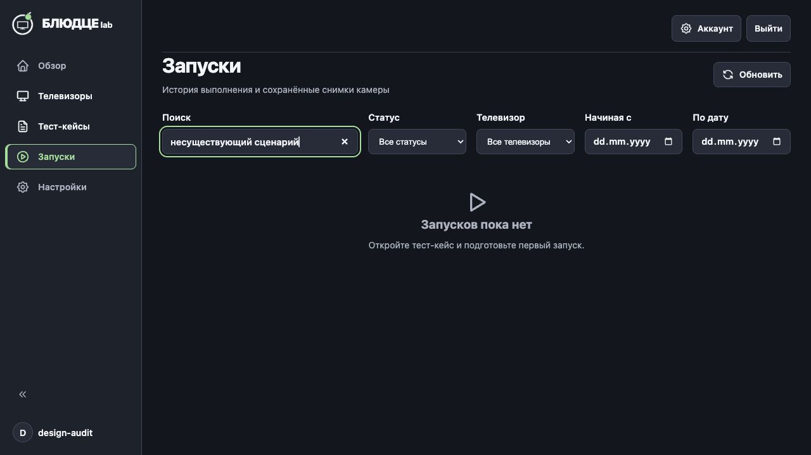
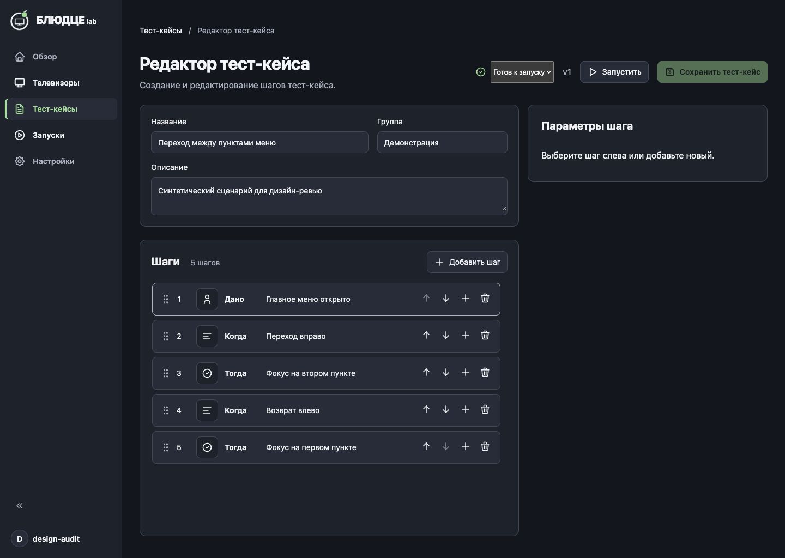
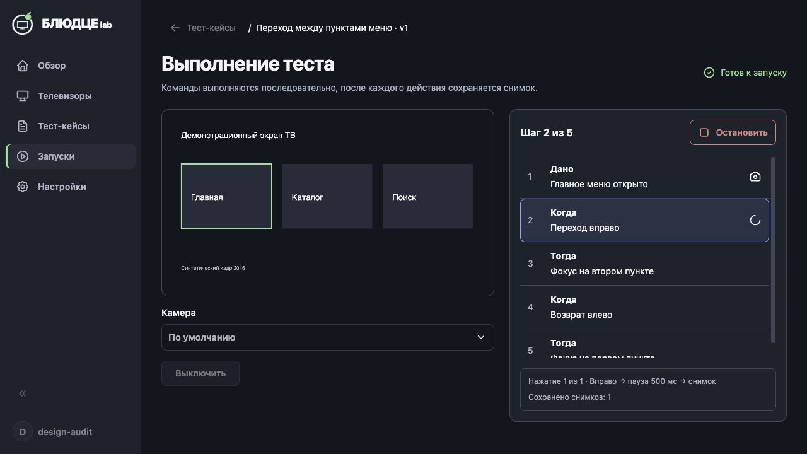
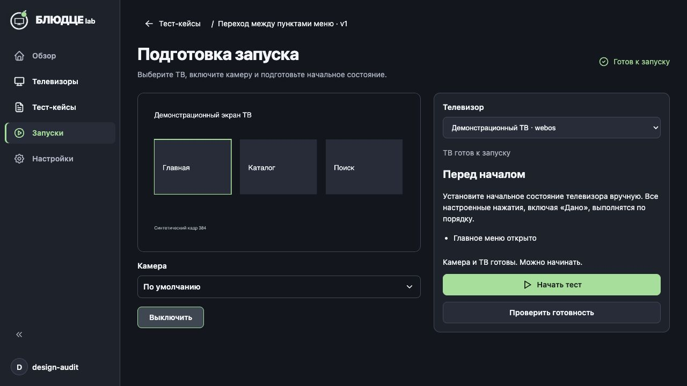
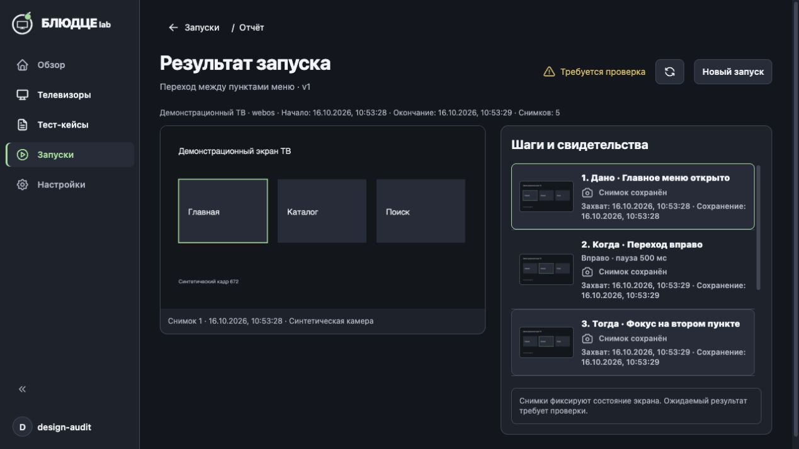
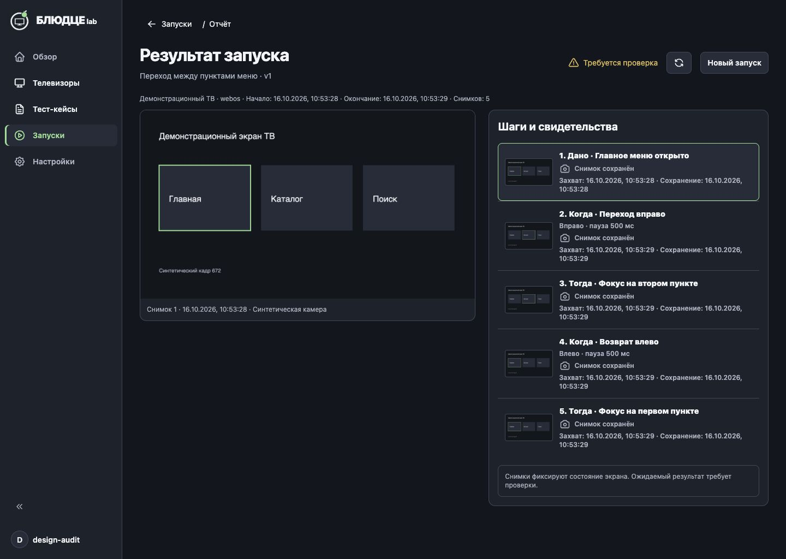

# Дизайн-ревью запуска со снимками

Дата: 2026-10-16. Проверена текущая собранная версия интерфейса в Codex In-app Browser. Свежие снимки сделаны в ходе этого ревью. Продуктовый код не изменялся.

## Вывод

Композиция согласована с референсом: камера слева, шаги справа, внутренние прокрутки, доступная остановка. Сохранённый снимок не выдается за успешную проверку. До дизайн-приёмки нужно устранить три замечания P2; три P3 улучшают ясность и плотность интерфейса. Блокирующих P1 в проверенных состояниях не обнаружено.

## Основания и границы

Источники: [общая дизайн-система](../../../superpowers/specs/2026-10-11-product-ui-design.md), [ТЗ раннера](../../../superpowers/specs/2026-10-15-camera-runner-design.md), [референс и согласованные поправки](../../mockups/2026-10-15-runner/README.md). Поправки имеют приоритет над случайными деталями генерации: зелёное активное меню, недоступный старт без камеры, значок снимка вместо галочки успеха.

Использована изолированная копия текущей сборки с синтетическими ТВ, камерой и кейсами. Реальные устройства, пользовательские сценарии и видеопоток не затрагивались. Основная проверка — 1280×720; дополнительные настольные размеры — 1024×768 и 1440×1024. Референс объединяет три состояния в одном изображении: сравнивалась композиция соответствующего состояния, точные размеры определяет ТЗ.

Проверены видимый фокус, доступные имена основных действий, выбор кадра и защита черновика. Полный проход с клавиатуры, скринридер, измерение контраста, масштаб 200%, светлая тема и английский язык не проверены. Это не заключение о соответствии WCAG. Отказ разрешения камеры, потеря физического ТВ и заполнение диска не воспроизводились; проверен технический сбой доставки на синтетическом адаптере.

## Проверенные шаги

| № | Шаг | Состояние | Свидетельство |
|---|---|---|---|
| 1 | Список кейсов: Play и пустой кейс | Хорошо: причина недоступности видна | [01](01-cases.png) |
| 2 | Запуск из редактора, несохранённые изменения | Требует правки оформления поля; защита работает | [14](14-editor.png), [15](15-unsaved-dialog.png) |
| 3 | Подготовка, камера выключена/готова | Работает; уточнить обозначения статусов | [02](02-preparation-off.png), [03](03-preparation-ready.png) |
| 4 | Выполнение и текущий шаг | Работает; статус кейса неоднозначен | [04](04-execution.png) |
| 5 | Отчёт, выбор другого кадра, ошибка | Требует правки пути назад и плотности | [05](05-report-error.png), [06](06-report.png), [07](07-report-selection.png), [08](08-back-destination.png) |
| 6 | Длинные предусловия | Хорошо: прокрутка внутри, старт остаётся видимым | [09](09-long-preparation.png), [10](10-preparation-1024.png), [11](11-preparation-1440.png) |
| 7 | История и поиск | Требует отдельного пустого результата поиска | [12](12-history.png), [16](16-history-no-results.png) |

## Находки

### 1. P2 — «Запуски» возвращает в «Тест-кейсы»

После завершения запуска нажать хлебную крошку «Запуски» в отчёте. Открывается список кейсов, активный раздел меняется на «Тест-кейсы». Из истории тот же отчёт возвращает правильно. Подпись обещает другое назначение, пользователь теряет ожидаемый путь к истории.

Рекомендация: отчёт всегда возвращает в историю запусков; подготовка отдельно возвращает к кейсам. Причина: `TestRunner.tsx:26` передаёт отчёту собственный `onBack`; `Home.tsx:137` задаёт ему переход к кейсам. Подпись отчёта — `TestRunReport.tsx:10`.

### 2. P2 — пустой поиск сообщает об отсутствии истории

В истории есть два запуска. Поиск без совпадений показывает «Запусков пока нет» и предлагает первый запуск. Состояние подтверждено после завершения загрузки и повторным воспроизведением. Это может создать впечатление потери сохранённых результатов.

Рекомендация: при активных фильтрах показывать «Ничего не найдено» и действие сброса; первый запуск предлагать только при действительно пустой истории без фильтров. Владелец — ветка пустого списка `TestRuns.tsx:13`, которая проверяет только длину текущего ответа.

### 3. P2 — переключатель готовности не оформлен как общее поле

В редакторе поле «Готов к запуску» выглядит нативным серым прямоугольником с мелким текстом, тогда как соседние поля используют проектную поверхность и скругление. Измеренные стили: высота 40 px, радиус 0 px, шрифт 13.33 px, фон rgb(59,59,59). Высота соответствует ТЗ, оформление — нет.

Рекомендация: применить общие стили select (радиус 8 px, типографика 14/20, поле и граница из токенов). Не менять смысл готовности. Владелец: `TestCaseEditor.tsx:79`, `style.css:714`.

### 4. P3 — статус кейса выглядит статусом текущего выполнения

На экране «Выполнение теста» справа остаётся зелёное «Готов к запуску», одновременно текущий шаг обозначен синим. Само сохранение готовности кейса корректно; без подписи «Кейс» пользователь может принять её за состояние запуска.

Рекомендация: явно подписать «Кейс: готов к запуску» рядом с версией, а статус выполнения показывать отдельно с текстом и индикатором. Владелец: заголовок `TestRunner.tsx:28`.

### 5. P3 — готовность ТВ не использует общий язык статусов

«ТВ готов к запуску» показано вторичным серым текстом без значка. ТЗ требует для готовности зелёный цвет, текст и подходящий значок. Рядом уже есть визуально оформленная готовность кейса, поэтому одинаковые слова выглядят несогласованно.

Рекомендация: общий компонент состояния оборудования с текстом и иконкой; отдельно показывать проверку, готовность и недоступность. Владелец: `TestRunner.tsx:31`, `.runner-device-status` в `style.css:743`.

### 6. P3 — служебные даты перегружают список свидетельств

В каждой строке одновременно повторяются дата захвата и дата сохранения, обе переносятся; все подписи выглядят насыщенными. При 1280×720 видно около трёх из пяти записей. На 1440×1024 все пять помещаются, однако служебные данные всё ещё конкурируют с описанием шага. Это улучшение читаемости, а не отсутствие обязательных данных.

Рекомендация: оставить в строке шаг, команду и короткое время захвата; полные времена и камеру показывать в деталях выбранного свидетельства. Сохранить доступ ко всем обязательным данным и явную подпись «Снимок сохранён». Владелец: `TestRunReport.tsx:11`, `style.css:758–764`.

## Что сохранить

- Камера остаётся основным блоком; в отчёте кадр не обрезается под заполнение.
- Старт недоступен до готовности камеры; включение явно инициируется пользователем.
- Во время выполнения видны текущий шаг, команда, пауза и количество снимков; остановка вне прокручиваемого списка.
- Итог «Требуется проверка» и подпись «Снимок сохранён» сохраняют различие между свидетельством и визуальным вердиктом.
- Ошибка находится вне изображения и сообщает о неизвестной доставке без ложного успеха.
- Длинные предусловия не вытесняют действия за нижний край проверенных размеров окна.

Следующий шаг: исправить P2 в навигации, пустом поиске и общем поле, затем P3 и повторить визуальную проверку этих состояний. Исправления в рамках этого ревью не выполнялись.
