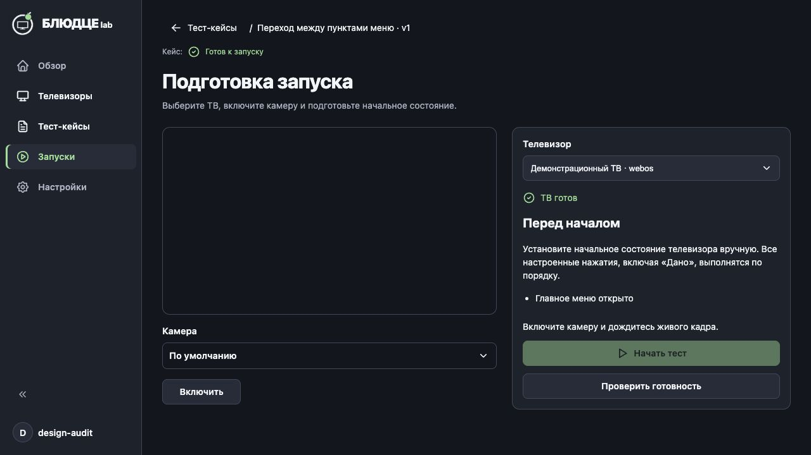
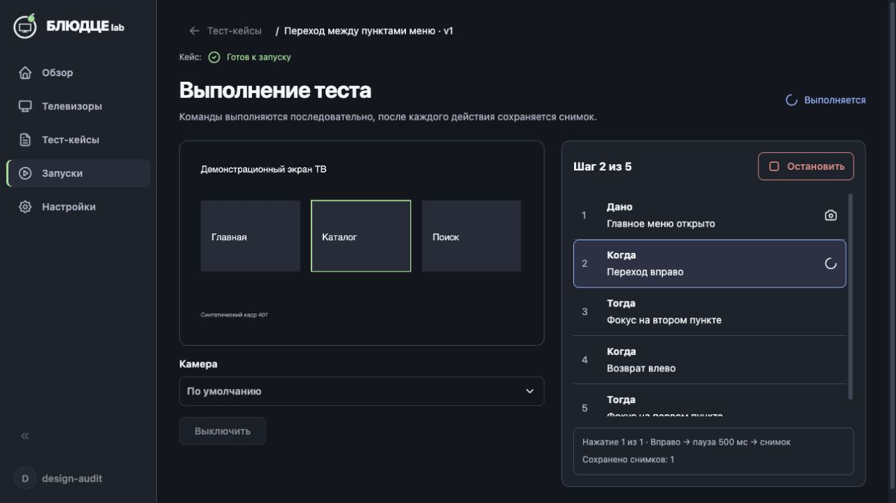
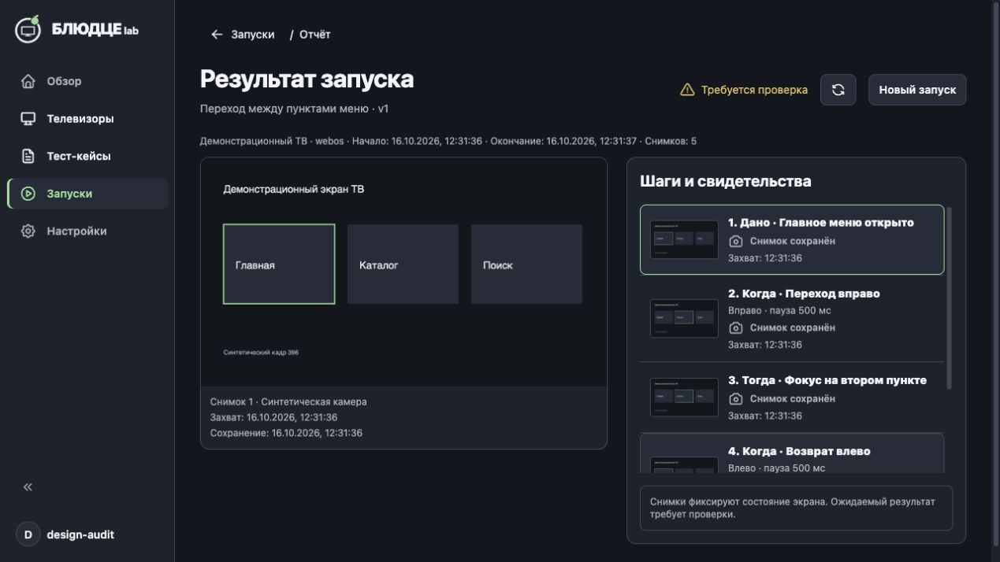
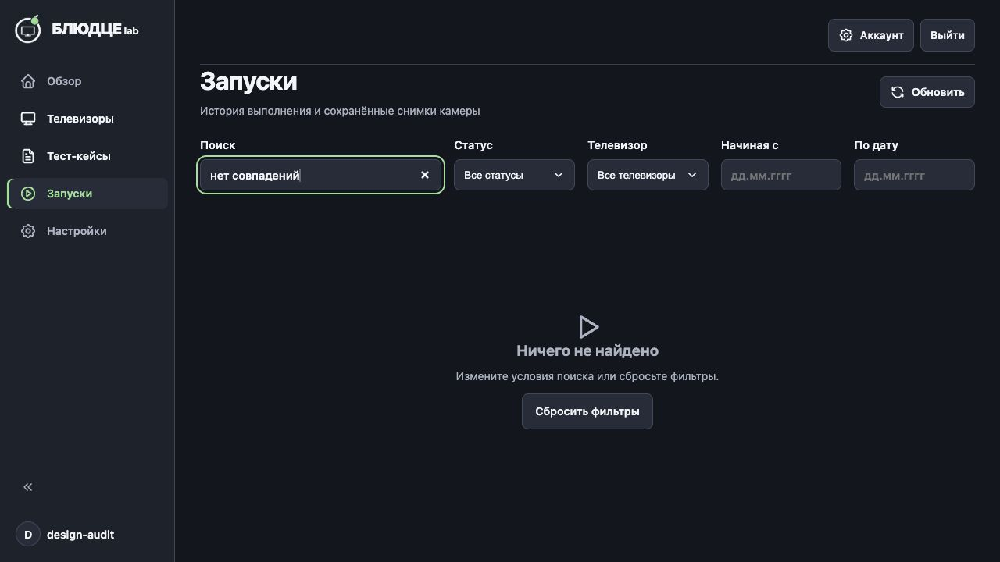
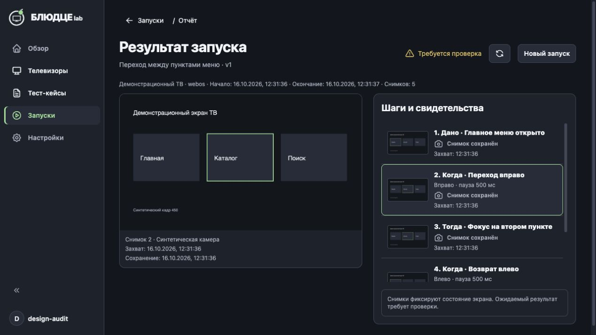

# Исправления дизайн-ревью раннера

Согласовано пользователем 2026-10-16. Закрыты пять оставшихся замечаний аудита; оформление переключателя готовности исправлено ранее.

- Из завершённого запуска и из истории хлебная крошка «Запуски» ведёт в историю. Подготовка сохраняет отдельный возврат к кейсам.
- Пустой ответ при активных фильтрах показывает «Ничего не найдено» и сброс всех фильтров. Без фильтров сохраняется состояние первого запуска.
- Готовность кейса подписана «Кейс» рядом с контекстом названия/версии. Во время исполнения основной статус — синий «Выполняется».
- Готовность ТВ использует зелёный значок и текст; проверка — синий индикатор, недоступность — красное предупреждение.
- Строка свидетельства содержит короткое время захвата. Полные даты захвата и сохранения, номер и камера доступны под выбранным изображением и меняются вместе с ним. Данные хранения не изменены.

Проверки: 441 тест веб-приложения прошёл, включая новые регрессии перехода из завершённого раннера и пустого поиска со сбросом; веб-сборка и Docker-сборка успешны, `git diff --check` без ошибок. Новая проверка пустого поиска до исправления падала на отсутствии «Ничего не найдено».

Свежая визуальная проверка проведена в in-app browser на изолированной копии той же сборки с синтетическими ТВ/камерой: два прогона по пять кадров, подготовка, выполнение, отчёт, выбор второго кадра, возврат именно хлебной крошкой сразу после завершения и из истории, поиск и сброс. Реальные ТВ не использовались. Композиция сверена с согласованным референсом раннера и общими токенами. Полный аудит доступности и остальные размеры окна в этой правке не повторялись.

Активный Docker обновлён с сохранением volume. Его вкладка после обновления показывает истёкшую сессию и экран входа; пользовательские экраны этой сессии после обновления не проверены, повторный вход оставлен пользователю.

Уточнение причины потери авторизации: повторные выходы при проверках вызваны тестовым входом на другом порту того же hostname, который заменял cookie пользовательской сессии. Перезапуск сервера с тем же volume сохраняет сессии. Проверочный стенд переведён на отдельный hostname; правило внесено в общее дизайн-ТЗ.
